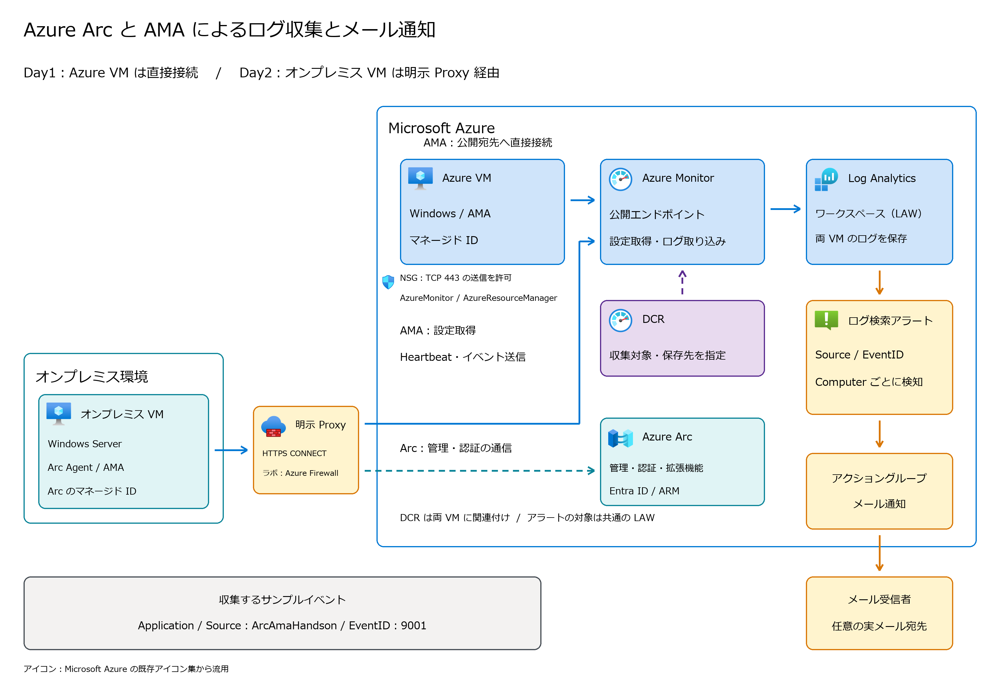

# Azure Arc と Azure Monitor Agent ハンズオン



Azure VM とオンプレミスの Windows Server から Windows イベントを収集し、Azure Monitor のアラートとメール通知を試すハンズオンです。
Azure Portal を中心に操作し、Windows 内の設定と Arc の登録には PowerShell を使用します。Step0 の検証環境構築では Azure CLI も使用します。

Azure VM は AMA から Azure Monitor の公開エンドポイントへ直接接続します。オンプレミス VM は Connected Machine Agent（Arc Agent）に明示 Proxy を設定し、AMA を Azure Portal から導入してログ収集を設定します。

構成図の編集用正本は [Excalidraw](docs/images/01-architecture.excalidraw) です。[SVG](docs/images/01-architecture.svg) も用意しています。

## 進め方

| ステップ | 内容 | 対象 | 実施日 |
|---|---|---|---|
| [Step0：検証環境の構築](docs/01-lab.md) | スクリプトで Azure VM、疑似オンプレミス VM、DNS、Firewall、Bastion を準備する。既存環境があれば省略できる | 講師・検証者 | 事前準備 |
| [Step1：Azure VM のログ収集](docs/02-azure.md) | LAW、DCR、AMA、送信許可を設定し、イベントの収集、アラート、メール通知を試す | Azure 環境の担当者 | Day1 |
| [Step2：オンプレミス VM のログ収集](docs/03-onpremises.md) | 明示 Proxy、Arc、AMA を設定し、Day1 の収集先とアラート規則で同じ演習を行う | オンプレミスと Azure の担当者 | Day2 |
| [4. オプション](docs/04-optional.md) | 監視用 RG の予算アラートを設定する、または Azure VM とオンプレミス VM の監視情報をワークブックで可視化する | Azure・オンプレミスの運用担当者、コスト管理の担当者 | 任意。演習ごとに前提が異なる |

Step0 で環境を準備し、Day1 は Step1、Day2 は Step2 の順に進めてください。
既存の Azure VM、オンプレミス VM と Proxy を使う場合は、Step1 から始められます。
Day1 の LAW、DCR、アラート規則、アクショングループは Day2 でも使用します。
予算アラートは監視用 RG の作成後、ワークブックは Step1 と Step2 の完了後に実施できます。予算アラートは費用を通知するもので、リソースや課金を自動停止するものではありません。

## このハンズオンで確かめること

1. Azure VM に AMA を導入し、Heartbeat と Application イベントを LAW に収集する。
2. オンプレミス VM を Arc に登録し、Arc と AMA が明示 Proxy を使用するように設定する。
3. オンプレミス VM の Heartbeat とイベントも同じ LAW に収集し、コンピューター名とリソース ID で収集元を見比べる。
4. 共通の Source `ArcAmaHandson`、EventID `9001` をログ検索アラートで検知する。
5. LAW を対象に `Computer` の現在値と将来値を含め、Day1 と Day2 の VM に同じアラート規則を使用する。
6. ご自身のメールアドレスを設定した場合は、アクショングループによる通知を受信する。

手順中の「確認してみよう」を使って、設定と結果を見比べながら進めてください。

## 始める前に

- 対象 Windows Server の管理者アカウントと、Azure リソースの作成・設定・ログ閲覧ができる Azure アカウントを用意してください。
- 既存環境では、監視、マネージド ID、DCR、Proxy、通信規則を確認してから進めてください。名前、ID、IP アドレス、リージョンはご自身の環境の値に置き換えます。
- オンプレミスの Proxy は、認証不要の HTTP Proxy と HTTPS CONNECT に対応したものを使用します。必要な通信先は Step2 に記載しています。
- インストーラー取得時の Proxy 指定と、導入後の Arc・AMA の Proxy 設定をそれぞれ確認してください。
- 資料のメールアドレスは架空の例です。受信も試す場合は、ご自身の判断で実際の宛先に置き換え、求められた宛先確認を行ってください。
- Azure リソース、ログの取り込みと保持、ログ検索アラートには費用が発生します。利用期間、予算、リージョンと Portal の推定コストを確認してください。

## 検証環境

Step0 は既存のラボ構築スクリプトを流用し、3 VNet、Azure Firewall Standard、Azure Bastion Standard、DNS Private Resolver、3台の Azure VM と Public IP、ディスクを作成します。
ログ収集の対象となる Azure VM と、Hyper-V ホスト内の Windows Server でオンプレミス環境を再現します。
構築後に各 VM の Internet 向け送信を制限し、Step1 と Step2 で演習に必要な通信を設定します。

通常の操作には Bastion を使用し、オンプレミス環境を再現した VM は Hyper-V Manager / VMConnect から操作します。具体的な構成、実行方法と参考費用は [Step0](docs/01-lab.md) を参照してください。

VM の割り当て解除後も Firewall、Bastion、DNS Private Resolver、Public IP、ディスクの課金は続きます。実行前に VM サイズ、リージョンの提供状況とクォータも確認してください。

## 資料の取得

```powershell
git clone https://github.com/uedait/arc-ama-handson.git
Set-Location .\arc-ama-handson
```

## ライセンス

構築資材と各ステップの手順は [uedait/ampls-arcpls-handson](https://github.com/uedait/ampls-arcpls-handson/tree/e11b5b5fbf35e3535c29dd79cab1947c46011860) を基にしています。文書とコードは [MIT License](LICENSE) で提供します。Microsoft の画面・アイコンなどの第三者素材には、提供元の利用条件が適用されます。

## 注意事項

- ハンズオンの作成日は `2026-11-24` です。
- 構文、構築資材、合成データによるローカル検査を実施しています。今回の構成での Azure 実機検証とメール受信検証は未実施です。
- 記載内容は動作を保証するものではありません。Azure の仕様、Portal の画面、設定項目は今後変更になる可能性があります。
- 各章の Microsoft Learn のリンクも参照して、手順と設定値を確認してください。